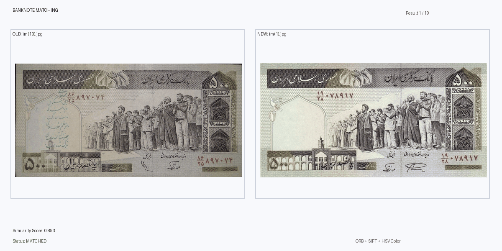

# Banknote
# Banknote Image Matching with OpenCV

## Overview

This project explores how computer vision can be used to identify matching banknote images across two datasets. The goal is to take an image from an older dataset, compare it with images in a newer dataset, and find the most likely match based on visual similarities.

Instead of relying on color alone, the system looks at both the **structural details** of banknotes and their **color distribution**. It also generates an animated GIF to make the matching results easier to understand and present.

The project was built with Python and OpenCV, with a focus on practical image processing, feature matching, and visual result analysis.

## 🎬 GIF Preview

<!-- Replace the path below with the location of your GIF in the repository. -->



*The animation shows the original banknote image alongside its selected match, including the similarity score and matching status.*

## How It Works

The matching pipeline follows several steps:

1. **Image preprocessing**  
   Images are resized to a standard width to make comparisons more consistent. Contrast enhancement and noise reduction help improve feature detection.

2. **Feature extraction**  
   ORB and SIFT are used to detect distinctive visual features in each banknote image.

3. **Structural similarity**  
   Feature descriptors are matched using a ratio test. When enough matches are available, RANSAC-based homography estimation helps identify geometrically consistent matches.

4. **Color similarity**  
   HSV color histograms are compared to measure similarities in color distribution.

5. **Combined scoring**  
   Structural and color scores are combined into a single similarity score.

6. **Matching and visualization**  
   The system selects matching candidates, saves a text report, visualizes the score matrix, and creates an animated GIF of the results.

## Matching Methods

### ORB

ORB provides a relatively fast way to detect and match distinctive image features. It is useful for comparing details such as patterns, symbols, and other visual elements on banknotes.

### SIFT

SIFT provides another approach to feature detection and descriptor matching. In this project, it acts as an additional structural matching method, helping when ORB alone does not produce the strongest result.

### HSV Color Histograms

Structural features do not tell the whole story. The project also compares HSV color histograms to account for similarities in the overall color distribution of banknotes.

### RANSAC and Homography

When enough feature matches are available, RANSAC and homography estimation help distinguish geometrically consistent matches from unreliable ones.

## Scoring

The final similarity score combines structural similarity and color similarity using configurable weights.

| Component | Weight |
|---|---:|
| Structural similarity (ORB/SIFT) | 65% |
| HSV color similarity | 35% |

The structural score uses the stronger result from ORB and SIFT when the SIFT fallback option is enabled.

A configurable minimum acceptance score determines whether a candidate is considered a confident match. The default threshold is `0.35`.

**Note:** The similarity score is a heuristic measure, not a calibrated probability. A higher score indicates stronger similarity according to the implemented scoring method, but it does not guarantee that two images represent the same banknote.

## Matching Modes

The project supports two matching modes.

- **Classification mode:** Each old image is matched independently with its highest-scoring candidate. Multiple old images may select the same new image.
- **Unique assignment mode:** The Hungarian algorithm is used to find a global one-to-one assignment between old and new images, subject to the configured acceptance threshold.

The default mode is `classification`.

## Output Files

After running the pipeline, the project generates the following outputs:

| Output | Description |
|---|---|
| `matched_images.txt` | Matching results, similarity scores, and match statuses |
| `banknote_matching.gif` | Animated visualization of the matching results |
| `score_heatmap.png` | Heatmap showing similarity scores between old and new images |

The output paths can be customized in the configuration section of the script.

## Technologies Used

- **Python** — Main programming language
- **OpenCV** — Image preprocessing, feature extraction, and matching
- **NumPy** — Numerical operations and score matrices
- **Pillow (PIL)** — GIF generation and image rendering
- **Matplotlib** — Similarity heatmap visualization
- **SciPy** — Hungarian algorithm implementation through `linear_sum_assignment`
- **ThreadPoolExecutor** — Parallel feature extraction and score calculation

## Getting Started

### Requirements

Install the required libraries:

```bash
pip install opencv-python numpy matplotlib pillow scipy
```

### Dataset Setup

The current script is configured to run in Google Colab using Google Drive.

Place your images in two separate folders:

- `Banknote test` — the old banknote images
- `Banknote Dataset` — the new banknote images to compare against

Update the folder paths in the configuration section if your datasets are stored elsewhere.

### Run the Project

1. Open the script in Google Colab.
2. Mount Google Drive if you are using the default paths.
3. Make sure both image folders exist and contain supported image files.
4. Run the script.

The matching report, score heatmap, and animated GIF will be saved to the configured output locations.

## Configuration

Some of the main settings can be adjusted directly in the script:

| Setting | Purpose |
|---|---|
| `STANDARD_WIDTH` | Standard width used for image normalization |
| `WEIGHT_STRUCTURE` | Weight assigned to structural similarity |
| `WEIGHT_COLOR` | Weight assigned to color similarity |
| `MATCHING_MODE` | Selects classification or unique assignment |
| `MIN_ACCEPT_SCORE` | Minimum score required for an accepted match |
| `USE_SIFT_FALLBACK` | Enables or disables SIFT-based structural matching |
| `MAX_WORKERS` | Controls the maximum number of worker threads |
| `GIF_DURATION` | Time each GIF frame remains visible |

## Project Goals

This project was an opportunity to explore how different computer vision techniques can work together on a practical image-matching problem. It combines feature-based matching, color analysis, geometric verification, score-based decision-making, and visual reporting in one pipeline.

It also highlights an important point in computer vision: no single similarity measure is perfect. Combining complementary techniques can provide a more useful comparison than relying on just one visual feature.

## Future Improvements

Some possible directions for further development include:

- Testing the matching pipeline on larger and more diverse datasets
- Evaluating precision, recall, and matching accuracy using labeled image pairs
- Improving robustness to rotation, perspective changes, lighting, and image quality
- Adding a confusion matrix and more detailed evaluation reports
- Building a simple interface for uploading images and reviewing candidate matches
